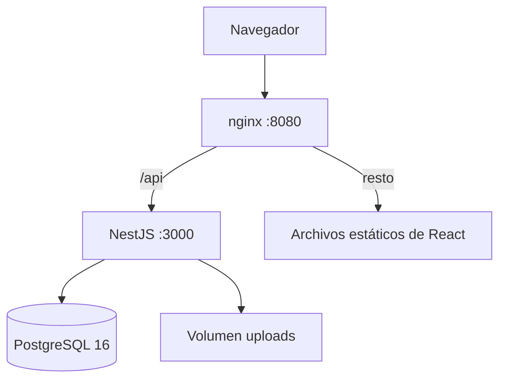
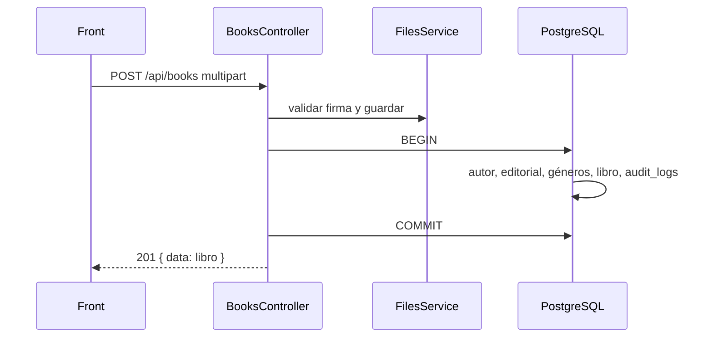

# CMPC Libros

Inventario de la tienda. Se puede buscar, filtrar, ordenar por más de una columna y paginar en el servidor. También hay ficha, alta y edición con portada, baja lógica, Excel y una bitácora de lo que se hizo.

El back es NestJS con Prisma y PostgreSQL. El front es React. Los dos van en TypeScript. El login entrega un JWT. Viven en el mismo repositorio y se despliegan por separado.

## Cómo levantarlo

Hace falta Docker con Compose.

```bash
docker compose up --build
```

- App: http://localhost:8080
- Swagger: http://localhost:8080/api/docs
- Postgres, si se quiere mirar la base: `localhost:5432`, base `cmpc_libros`, usuario `cmpc`, clave `cmpc_libros`

Al arrancar, el back corre las migraciones y carga el catálogo si no hay libros. Las portadas quedan en el volumen `cmpc_uploads`.

`docker compose down` apaga y deja los datos. `docker compose down -v` borra también la base y las imágenes.

Usuario de prueba:

- `admin@cmpc-libros.cl`
- `Admin123!`

### En local

Node.js 22. Postgres sigue en Docker.

```bash
docker compose up -d db
cp backend/.env.example backend/.env
cp frontend/.env.example frontend/.env
npm install --prefix backend
npm install --prefix frontend
npm run prisma:migrate --prefix backend
npm run prisma:seed --prefix backend
```

En una terminal `npm run dev:api`, en otra `npm run dev:web`.

- Front: http://localhost:5173
- Swagger: http://localhost:3000/api/docs

Vite proxea `/api` al puerto 3000. En Docker, nginx hace lo mismo, así que el front siempre pega al mismo origen.

## Recorrido

1. Entrar con el usuario de arriba.
2. En Libros, buscar por título, autor o editorial. Espera 350 ms antes de pegarle al back.
3. Filtrar por género, autor, editorial y disponibilidad. Se pueden combinar.
4. Ordenar por una o más columnas. Otro clic en la misma columna da vuelta la dirección. La pastilla del orden saca ese campo. Viaja como `sort=price:desc,title:asc`.
5. Cambiar de página. El total lo calcula el servidor (`page` y `limit`).
6. Exportar a Excel. Sale con los mismos filtros y el mismo orden, sin paginar.
7. Abrir un libro, editarlo o eliminarlo. La eliminación pide confirmación y es lógica.
8. Crear uno con imagen. Autor, editorial y género se eligen o se escriben. Si el nombre no existe, se crea en la misma operación.
9. En Auditoría se ve la bitácora.

## Arquitectura



En local, Vite ocupa el lugar de nginx.

### Back

| Módulo | Qué hace |
| --- | --- |
| `auth` | Login, hash de la contraseña, emisión y validación del JWT |
| `books` | CRUD, filtros, orden, paginación, Excel y las reglas del libro |
| `catalog` | Lectura de autores, editoriales y géneros |
| `audit` | Escritura y consulta de la bitácora |
| `files` | Validar la firma del archivo, guardarlo y borrarlo |
| `health` | `SELECT 1` para el healthcheck de Docker |
| `prisma` | Cliente compartido |
| `common` | Guard, filtro de errores, interceptores, orden y Excel |

`AppModule` registra como globales el guard JWT, el interceptor de logging, el interceptor que envuelve la respuesta y el filtro de excepciones.

Cada módulo cambia por una razón. `FilesService` valida la firma, guarda el archivo y lo borra. `BooksService` arma el libro y la transacción. `AuditService` persiste la fila que le pasan. El login no entra en ninguno de esos tres.

`Actor` lleva el id del usuario y la IP. Alta, edición y consulta tienen cada una su DTO. Los controladores reciben los servicios por constructor, y en los tests se sustituye Prisma, el auditor y el almacenamiento sin levantar Nest ni Postgres.

Un alta queda así:



Si la transacción falla, el back borra el archivo que acababa de guardar.

La auditoría acepta el cliente de Prisma o el de la transacción, así la baja y su log se confirman juntos. Ordenar por una columna nueva es agregar el campo a la lista blanca de `parseSort`. El controlador sigue igual.

`TransformInterceptor` envuelve el resultado. Si el servicio ya devolvió `data` y `meta`, solo agrega `timestamp`. `SkipTransform` deja salir el Excel sin ese sobre. `HttpExceptionFilter` responde siempre con `statusCode`, `message`, `error`, `timestamp` y `path`. Si Multer rechaza el tamaño, el mensaje es «La imagen no puede superar 2 MB». Un unique de Prisma (`P2002`) responde 409.

### Front

La sesión queda en `localStorage` (`token` y `user`). Un 401 que no sea el del login dispara `auth:unauthorized`, limpia la sesión y las pantallas protegidas vuelven a `/login`.

El listado arma la consulta en el servidor: debounce de 350 ms, filtros por id, orden de varias columnas y página. React Query cachea el catálogo y el resultado. El formulario valida con Zod en cada cambio y, cuando pasa, arma el `FormData`. Si la petición falla, el mensaje queda en un banner.

## Modelo

[Modelo relacional](docs/modelo-relacional.png)

La fuente para [dbdiagram.io](https://dbdiagram.io) está en [docs/modelo-relacional.dbml](docs/modelo-relacional.dbml).

Un libro no guarda el nombre del autor ni el de la editorial: guarda la clave. El filtro «todos los de Alfaguara» es un índice sobre `publisher_id`, y corregir un nombre no obliga a recorrer los libros. Los nombres se comparan sin importar mayúsculas, para no terminar con "Anagrama" y "anagrama".

El género es muchos a muchos (`book_genres`) porque un mismo título puede ser Infantil y Fantasía. La clave primaria compuesta impide repetir el par, y el índice de `genre_id` acelera el filtro. El seed trae doce géneros; el formulario deja agregar otro. El catálogo es de demostración: las editoriales son las de las ediciones de referencia, no un inventario real de CMPC.

`deleted_at` nulo significa vigente. Las consultas del inventario incluyen `deleted_at IS NULL`. `audit_logs.user_id` es opcional para poder anotar un login fallido de alguien que no existe. Si el usuario se eliminara, la bitácora queda y la clave pasa a nulo (`ON DELETE SET NULL`). Autor y editorial no se pueden borrar mientras tengan libros (`ON DELETE RESTRICT`). Un género en uso tampoco. Si el libro se borra de la base, sus filas de `book_genres` se van con él (`ON DELETE CASCADE`). La baja de la aplicación no llega a eso: solo escribe `deleted_at`.

Índices del listado:

- `books(title)`, `books(author_id)`, `books(publisher_id)`, `books(stock)`, `books(price)`, `books(created_at)`, `books(deleted_at)`
- `book_genres(genre_id)`, además de la primaria `(book_id, genre_id)`
- `audit_logs(entity, entity_id)`, `audit_logs(user_id)`, `audit_logs(created_at)`
- únicos: `users.email`, `authors.name`, `publishers.name`, `genres.name`

La búsqueda de texto usa `ILIKE`. Con este tamaño de catálogo el plan es barato. Si el fondo creciera a cientos de miles de títulos, el paso siguiente sería `pg_trgm` sobre `title`, en una migración, cuando Prisma pueda representarlo sin drift.

## Decisiones

Disponibilidad es el stock. Cero o más, y el libro está disponible si el stock es mayor que cero. El listado filtra por eso y la ficha muestra el número y el estado.

La baja escribe `deleted_at`. El libro sale del listado, del Excel y ya no se puede editar. La fila y su auditoría se quedan.

El enunciado pide exportar a CSV. Lo dejé en Excel (`.xlsx`), con los mismos filtros y el mismo orden del listado, sin paginar. La hoja se llama Inventario y trae título, autor, editorial, géneros, precio en pesos, stock y disponibilidad. Así el precio y la lista de géneros no dependen del separador de miles ni de la coma.

Las imágenes van a una carpeta local (`uploads`). En producción irían a un storage de objetos. `image_url` no cambia.

Hay un solo usuario operativo. Quien entra puede ver y modificar el inventario. El enunciado pide JWT, y con eso alcanza: no hay roles.

La bitácora guarda login, login fallido, alta, edición, baja y exportación. Cada request además queda en el log de acceso. Las lecturas del listado no entran a `audit_logs`, porque si no la tabla se llena de tráfico y se pierde lo que importa.

Precio y stock se validan en el back (no negativos). No puse un `CHECK` en Postgres: Prisma no lo declara en el schema y la migración siguiente lo iba a marcar como drift.

El alta, la edición, la baja y la exportación corren en una transacción junto con su registro de auditoría. Si el alta falla después de guardar la imagen, el archivo se borra.

El JWT es un guard global. Login, health y Swagger van con `@Public()`. Una ruta nueva queda protegida sola.

La validación está en los dos lados: Zod en el formulario, `class-validator` en el back. El servicio vuelve a pedir autor, editorial y al menos un género, porque esa regla junta varios campos.

## Rutas

Swagger está en `/api/docs`. Con Authorize se pega el token (`Bearer <token>`) y se pueden probar las operaciones.

Lo que sale bien viene envuelto:

```json
{ "data": {}, "timestamp": "2026-10-09T21:00:00.000Z" }
```

Los listados agregan `meta` con `page`, `limit`, `total` y `totalPages`. El Excel sale crudo, sin ese sobre.

Los errores tienen siempre la misma forma:

```json
{
  "statusCode": 400,
  "message": "Debe indicar un autor",
  "error": "Bad Request",
  "timestamp": "2026-10-09T21:00:00.000Z",
  "path": "/api/books"
}
```

Alta con curl, después de tener el token:

```bash
curl -X POST http://localhost:3000/api/books \
  -H "Authorization: Bearer $TOKEN" \
  -F "title=Altazor" \
  -F "price=12990" \
  -F "stock=5" \
  -F "authorName=Vicente Huidobro" \
  -F "publisherName=Editorial Universitaria" \
  -F 'genreNames=["Poesía"]' \
  -F "image=@portada.jpg"
```

Rutas principales: `POST /api/auth/login`, `GET/POST /api/books`, `GET/PATCH/DELETE /api/books/:id`, `GET /api/books/export`.

## Tests

```bash
npm test
npm run test:cov
```

El umbral es 80 % de sentencias, ramas, funciones y líneas, en el back y en el front. Jest cubre servicios, controladores, el filtro de errores, los interceptores, el guard y el armado de la consulta. Vitest cubre el cliente HTTP, la validación del formulario, el debounce y las pantallas.

## Variables

| Variable | Para qué |
| --- | --- |
| `DATABASE_URL` | Conexión de Prisma |
| `JWT_SECRET` | Firma del token. Cambiarla fuera de local |
| `JWT_EXPIRES_IN` | Vigencia. Por defecto `8h` |
| `UPLOAD_DIR` | Carpeta de imágenes |
| `PORT` | Puerto del back. Por defecto `3000` |
| `CORS_ORIGIN` | Orígenes permitidos, separados por coma |
| `SEED_ON_START` | En Docker, siembra si la tabla de libros está vacía |
| `VITE_API_URL` | Base del back en el front. `/api` cuando hay proxy |
